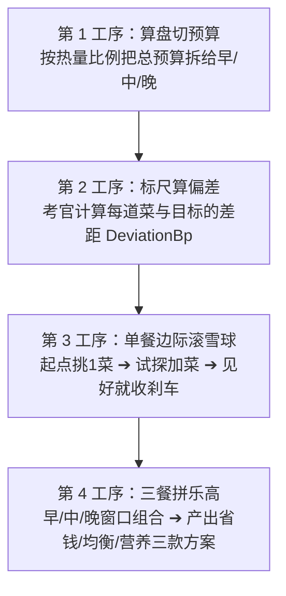

# 《天科食客》底层算法通俗精讲（一）：贪心算法（Greedy）

> **作者/主讲人**：任潇宇  
> **归属工程**：天科食客（天津科技大学西一食堂智能就餐优化系统）  
> **底层源码**：[`core/src/planner.cpp`](file:///d:/项目/cpp/Projects/食堂就餐优化系统/core/src/planner.cpp#L1435-L1750)  
> **阅读对象**：零基础小白、期末答辩备考、工程技术复盘

---

## 一句话记住贪心算法
> **“走一步看一步，只挑当前最好的，绝不纠结、绝不回头！”**

---

## 一、 生活场景还原：你去西一食堂打快餐

想象一下这个真实场景：
你快要上课迟到了，冲进天津科技大学西一食堂的川湘风味窗口打午饭，排队只有 1 分钟。  
你脑子里的目标是：**“这顿饭我想吃够 25 克蛋白质，预算 15 块钱左右”**。

这时候你是怎么打饭的？
1. **先挑第一道菜（定基底）**：你一眼扫过橱窗，看中了**小炒黄牛肉**。它蛋白质高、价格合理，你毫不犹豫：“阿姨，来一份牛肉！”
2. **看还要不要加菜（边际贪心）**：阿姨问你：“同学，还要别的吗？”  
   你瞄了一眼盘子里的牛肉，心里盘算：牛肉蛋白质有了，但热量还差一点点，维生素不够。你看到旁边的**手撕包菜**只要 3 块钱，热量低还补充纤维，立刻说：“再加一份包菜！”
3. **什么时候收手（刹车判定）**：阿姨又问：“再来个炸鸡腿不？”  
   你一看钱包已经花了 13 块，再加鸡腿不仅超预算，而且油脂直接爆表。你果断摆手：“不要了，结账！”

在这个过程中，你**从来没有回头去想**：“如果我刚才第一道菜不点牛肉，而是点辣子鸡，会不会待会儿配米饭更划算？”  
你只顾眼前的每一步都要比刚才更好，挑满了就走——**这就是贪心算法！**

---

## 二、 算法 4 大工序全景拆解

在 [`planner.cpp`](file:///d:/项目/cpp/Projects/食堂就餐优化系统/core/src/planner.cpp) 中，贪心算法从用户点击“开始规划”到屏幕弹出推荐，完整经历了 4 个工序：



---

### 第 1 工序：算盘切预算（防止早餐败光全天的钱）
* **对应函数**：[`RunGreedyAlgorithm`](file:///d:/项目/cpp/Projects/食堂就餐优化系统/core/src/planner.cpp#L1705-L1712)
* **小白痛点**：贪心算法“只顾眼前”。如果全天预算 30 元，早餐看到 15 元的豪华牛肉包，它可能一冲动就买了，导致中午晚上饿肚子。
* **代码的对策**：**按热量比例分配软上限！**
  ```cpp
  // 源码片段 (L1711)：
  // 某餐预算额度 = (全天剩余预算 * 本餐参考热量) / 全天总热量
  share = (dayRemainingBudget * mealEnergy) / totalMealRefEnergy;
  ```
* **具体案例**：
  * 全天目标热量：早餐 400 kcal、午餐 800 kcal、晚餐 800 kcal（总计 2000 kcal）；
  * 全天预算：30 元；
  * **切分结果**：
    * 早餐分配：$30 \times (400 \div 2000) = \mathbf{6\text{ 元}}$；
    * 午餐分配：$30 \times (800 \div 2000) = \mathbf{12\text{ 元}}$；
    * 晚餐分配：$30 \times (800 \div 2000) = \mathbf{12\text{ 元}}$。
  * 这样就给早餐设定了一道“软上限”：早餐挑菜时不能超过 6 块钱！

---

### 第 2 工序：标尺算偏差（考官到底是怎么给菜“打分”的？）
* **对应函数**：[`DeviationBp`](file:///d:/项目/cpp/Projects/食堂就餐优化系统/core/src/planner.cpp#L400) 与 [`WeightedTerm`](file:///d:/项目/cpp/Projects/食堂就餐优化系统/core/src/planner.cpp#L389)
* **核心打分机制**：
  电脑不认识“好不好吃”，它只看一个客观精准的**“数字标尺”——基点偏差分（Deviation in bp）**。
  $$1\text{ bp} = 0.01\% \quad (\text{比如偏差 } 500\text{ bp 就代表偏离了目标的 } 5\%)$$
* **考核的四大金刚**：**热量（Energy）、蛋白质（Protein）、脂肪（Fat）、碳水（Carb）**。
  ```cpp
  // 源码逻辑 (L395-L396)：
  const i64 difference = known >= targetValue ? known - targetValue : targetValue - known;
  return RoundHalfUp(difference * 10000 * weight, targetValue * 1000);
  ```
* **打分规则**：
  * **0 分**：神级匹配！不多不少正好命中目标；
  * **分越小越好**：50 分优于 200 分，200 分优于 1000 分；
  * **不足和超标都会扣分**：少吃了扣分，爆卡爆脂同样扣分。

---

### 第 3 工序：单餐边际滚雪球（贪心加菜的核心现场）
* **对应函数**：[`BuildWindowGreedyMealPlans`](file:///d:/项目/cpp/Projects/食堂就餐优化系统/core/src/planner.cpp#L1439)

> **实战推演**：午餐目标 800 kcal，预算上限 12 元。算法走到 **川湘风味窗口**：

| 步骤 | 餐盘里现有的菜 | 剩余预算 | 当前总偏差分 | 算法这一步在干嘛？ | 决策结果 |
| :---: | :--- | :---: | :---: | :--- | :--- |
| **第 1 步 (起跑)** | （空盘子） | 12.0 元 | 极大值 ($\infty$) | 扫视橱窗单品：红烧肉(偏差800)、辣子鸡(偏差650)、小炒黄牛肉(偏差400) | **放进小炒牛肉 (10元)**<br/>偏差降至 **400** |
| **第 2 步 (加菜)** | 小炒牛肉 (10元) | 2.0 元 | 400 | 盘子没满（限3样），在剩下的菜里尝试组合：<br/>• 牛肉 + 狮子头 (要加5元超预算，扔掉)<br/>• 牛肉 + 手撕包菜 (要加2元，偏差降至 **120**)<br/>• 牛肉 + 白米饭 (要加1.5元，偏差降至 **260**) | **加上手撕包菜 (2元)**<br/>偏差降至 **120** |
| **第 3 步 (试探)** | 牛肉 + 包菜 (12元)| 0.0 元 | 120 | 盘子还差1样满额，但剩余预算只剩 0 元：<br/>• 再加任何菜都会超过 12 元预算上限！ | **触发刹车 (`!foundBetter`)**<br/>立即跳出循环结账！ |

---

### 第 4 工序：三餐拼乐高（最终如何交出答卷？）
* **对应函数**：[`EvaluateGreedyWindowCombinations`](file:///d:/项目/cpp/Projects/食堂就餐优化系统/core/src/planner.cpp#L1593)
* 每个窗口挑完之后：
  * 早餐挑出 12 个窗口的代表早餐；
  * 午餐挑出 12 个窗口的代表午餐；
  * 晚餐挑出 12 个窗口的代表晚餐；
* **组合与策略打分**：
  * 递归组合三餐（$12 \times 12 \times 12 = 1728$ 种组合，在电脑上算这 1700 种组合耗时 $<0.5\text{ ms}$）；
  * 同时筛选出三款方案供用户挑选：
    1. **省钱策略（Budget）**：花钱最少、营养及格的搭配；
    2. **均衡策略（Balanced）**：价格适中、营养均衡的最佳折中款；
    3. **营养策略（Nutrition）**：偏差分最小、最严格贴合健康目标的款式。

---

## 三、 底层 C++ 真实源码（逐行大白话对照）

```cpp
// 源码位置：core/src/planner.cpp (第 1484 行 ~ 1582 行)

// =========================================================================
// 第 1 步：在当前窗口中，先挑 1 道最贴近目标、且不超预算的菜作为“起点”
// =========================================================================
MealPlan currentPlan = MealPlan{};  // 相当于拿出一个空餐盘
bool hasCurrent = false;
i64 currentDev = 0;                 // 记录当前盘子里菜的“营养偏差分”（越小越好）

for (usize i = 0; i < mealSet.candidates.Size(); ++i) {
    const MealPlan& cand = mealSet.candidates[i];
    
    // 如果预算受限，且这道菜超过了单餐预算，直接跳过不看
    if (enforceMealBudgetCap && cand.knownPriceCents > mealBudgetCapCents) {
        continue;
    }
    
    // 【核心算分器】：计算这道菜的营养与我们目标的“偏差分”
    const i64 dev = DeviationBp(mealRef, cand.sums, config.weights);
    
    // 贪心判断：谁的偏差更小（更符合营养目标），谁就是盘子里的第一道菜！
    if (!hasCurrent || dev < currentDev ||
        (dev == currentDev && cand.knownPriceCents < currentPlan.knownPriceCents)) {
        currentPlan = cand;     // 放进餐盘
        currentDev = dev;       // 更新最好的偏差分
        hasCurrent = true;
    }
}

// =========================================================================
// 第 2 步：循环试探加菜（直到盘子里装满，或者继续加菜不再让营养变好为止）
// =========================================================================
while (static_cast<i64>(currentPlan.items.Size()) < config.maxItemsPerMeal) {
    const usize nextSize = currentPlan.items.Size() + 1; // 尝试加 1 道菜
    MealPlan bestNext = MealPlan{};
    bool foundBetter = false;
    i64 bestNextDev = currentDev; // 必须比现在的偏差更小才算及格

    // 遍历当前窗口所有菜品，看加哪一道最好
    for (usize i = 0; i < mealSet.candidates.Size(); ++i) {
        const MealPlan& cand = mealSet.candidates[i];
        
        // 【关键点】：必须包含刚才盘子里挑好的菜，不能反悔重选！
        if (!IsSuperset(cand, currentPlan)) {
            continue;
        }

        // 检查加了这道菜后会不会超预算
        if (enforceMealBudgetCap && cand.knownPriceCents > mealBudgetCapCents) {
            continue;
        }

        // 重新计算加上新菜之后的总营养偏差分
        const i64 dev = DeviationBp(mealRef, cand.sums, config.weights);
        
        // 【贪心之眼】：只要加了它之后，偏差分严格小于当前最佳，就暂定加它！
        if (dev < bestNextDev || 
            (foundBetter && dev == bestNextDev && cand.knownPriceCents < bestNext.knownPriceCents)) {
            bestNext = cand;
            bestNextDev = dev;
            foundBetter = true;
        }
    }

    // 【收手判定】：如果发现再加任何菜都不能让营养更好，或者都超预算了，立刻跳出循环（收手结账！）
    if (!foundBetter) {
        break; 
    }

    // 把最好的那一项确认放进盘子，继续下一轮试探加菜
    currentPlan = bestNext;
    currentDev = bestNextDev;
}

// 把挑好的这盘菜存下来，作为该窗口的最终推荐！
outWinPlans->Push(currentPlan);
```

---

## 四、 优缺点与适用场景对照

| 维度 | 贪心算法的表现 | 背后技术原因 |
| :--- | :--- | :--- |
| **计算速度** | **$< 1\text{ ms}$（极致飞速）** | 不做深度树状搜索、不穷举历史，只做单向加法 |
| **内存占用** | 几乎为零（几 KB） | 盘子里永远只存当前最优解，状态不膨胀 |
| **推荐质量** | **单餐优秀，全天局部最优** | 缺乏跨餐全局回溯能力（容易在某一餐吃猛了） |
| **最佳舞台** | 赶时间单餐打饭、手机电量不足极速秒开 | 追求极快响应与极低算力开销 |

---

## 五、 答辩现场高频问答速查（针对贪心算法）

> **评委提问**：“任同学，你们系统里既然有动态规划和分支限界，为什么还要特地保留一个‘贪心算法’？”
> 
> **高分应答参考**：  
> “老师，贪心算法是专门为**‘极致轻量与极速单餐’**设计的。  
> 在食堂高峰期，有的同学赶着去上课，只求 1 秒内推荐一顿合适的午饭，不需要全天重算。贪心算法通过单向边际加菜，不回溯、不纠结，**耗时在 1 毫秒以内**，在手机里几乎零功耗。它和动态规划、分支限界形成了高低搭配，满足不同场景的需求。”
