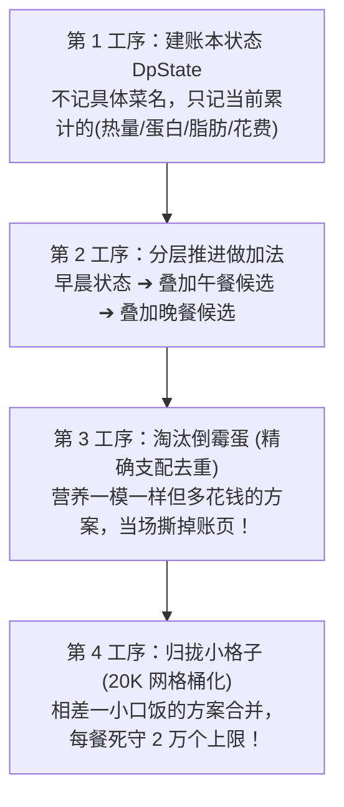

# 《天科食客》底层算法通俗精讲（二）：动态规划（DP 20K · 提速 330 倍核心攻坚）

> **作者/主讲人**：任潇宇  
> **归属工程**：天科食客（天津科技大学西一食堂智能就餐优化系统）  
> **底层源码**：[`core/src/planner.cpp`](file:///d:/项目/cpp/Projects/食堂就餐优化系统/core/src/planner.cpp#L1800-L2200)  
> **核心战绩**：从 **23.46 秒**卡死优化至 **71 毫秒**秒开，提速 **330.4 倍**，手机内存峰值仅 35 MB

---

## 一句话记住动态规划（DP 20K）
> **“通盘考虑早中晚，不算重复账，把差不多营养的方案归进小格子！”**

---

## 一、 生活场景还原：大管家的“记账本”

在贪心算法里，是你自己冲进食堂，看到好菜就抓，结果早餐吃猛了导致晚上喝西北风。  
要解决这个问题，你请来了一位**“极其精明的大管家”**来替你打理全天三餐。

大管家是怎么做决定的？
1. **早餐阶段（立账本）**：  
   大管家不急着拍脑袋定死你早餐吃啥。他在账本上列出几种有代表性的搭配，并记下**“累计状态”**：
   * 记录 A：吃了包子+豆浆 $\to$ 累计积累 400 大卡、花了 6 块钱；
   * 记录 B：吃了油条+馄饨 $\to$ 累计积累 450 大卡、花了 8 块钱。
2. **午餐阶段（在账本基础上做加法）**：  
   到了中午，大管家**绝对不去重新翻看早上的包子到底是什么馅**。他只看账本上的数字：
   * “针对记录 A（已有 400 大卡），午餐我配一份 800 大卡的套餐，全天就凑到了 1200 大卡！”
3. **晚餐阶段（收尾冲刺）**：  
   同理，晚餐直接在午餐留下的总账上继续加，直奔全天的总目标。

**【曾经的致命灾难】**：  
在老算法里，西一食堂早餐有 300 种搭配，午餐有 800 种，晚餐有 800 种。老代码做乘法全排列：$300 \times 800 \times 800 \approx \mathbf{1.92\text{ 亿种组合}}$！在电脑上整整卡死 **23.46 秒**，手机直接发烫闪退！  
大管家为了在手机上 **0.07 秒秒开**，使出了整套流水线工程。

---

## 二、 算法 4 大工序全景拆解

在底层核心源码 [`planner.cpp`](file:///d:/项目/cpp/Projects/食堂就餐优化系统/core/src/planner.cpp) 中，动态规划经历以下 4 个标准工序：



---

### 第 1 工序：建账本状态（`DpState` 到底记什么？）
* **对应源码**：[`DpState 结构体定义`](file:///d:/项目/cpp/Projects/食堂就餐优化系统/core/src/planner.cpp#L1805)
* **小白痛点**：如果算法把每一餐吃的所有菜名从头到尾背一遍，内存直接撑爆。
* **代码的对策**：账本极其精简，只记当前关键累积量：
  ```cpp
  struct DpState {
      NutritionValues sums;   // 当前累计：热量、蛋白质、脂肪、碳水
      i64 knownPriceCents;    // 当前累计：一共花了多少分钱
      u32 catMask;            // 食物种类：有没有覆盖肉/菜/蛋/奶
      i64 repeatedPairCount;  // 避重指标：今天有没有哪道菜吃重样了
  };
  ```

---

### 第 2 工序：分层向前推进（层层接力，绝不回头）
* **对应函数**：[`RunDpAlgorithm`](file:///d:/项目/cpp/Projects/食堂就餐优化系统/core/src/planner.cpp#L2015-L2036)
* 每一餐作为一个“阶段（Stage）”：
  * **第 0 层**：刚起床，体内热量为 0，花销为 0；
  * **第 1 层（早餐后）**：产生几百个早餐健康状态；
  * **第 2 层（午餐后）**：早餐状态与午餐菜品相加，形成中午累计状态；
  * **第 3 层（晚餐后）**：形成全天最终总账。

---

### 第 3 工序：淘汰倒霉蛋（精确支配去重 · 绝不算重复账）
* **对应函数**：[`DpExactDominates`](file:///d:/项目/cpp/Projects/食堂就餐优化系统/core/src/planner.cpp#L1890)
* **规则极度无情**：
  假设方案 A 和方案 B 到了午餐结束时：
  * 方案 A：热量 1200 kcal，蛋白质 45g，花销 **16 元**；
  * 方案 B：热量 1200 kcal，蛋白质 45g，花销 **22 元**；
  * **决策**：营养分毫不差，但方案 B 纯纯让你多当了一回冤大头（多花 6 块钱）。大管家立刻把方案 B **就地销毁**，晚餐再也不替它做任何推演！

---

### 第 4 工序：归拢小格子（20K 网格桶化 · 提速 330 倍的核心秘密！）
* **对应源码**：[`planner.cpp#L2068-L2136`](file:///d:/项目/cpp/Projects/食堂就餐优化系统/core/src/planner.cpp#L2068-L2136)
* **小白疑问**：如果方案 A 是 1201 大卡，方案 B 是 1203 大卡，它们营养不完全一样，支配去重杀不掉它们怎么办？
* **代码的绝招**：**划分网格桶（Quantization Bucketing）**！
  * **热量桶**：除以 20（20 大卡一个格子，`bE = energyKcal / 20`）；
  * **蛋白质桶**：除以 50（5 克一个格子，`bP = proteinDg / 50`）。

> **【数据走查表：看看小格子怎么把几万种方案压缩掉】**

| 方案编号 | 累计热量 | 累计蛋白质 | 累计花费 | 计算出的格子坐标 (热量格, 蛋白格) | 大管家的裁决 |
| :---: | :---: | :---: | :---: | :---: | :--- |
| **方案 1** | 802 kcal | 31.2 g | 14 元 | $(802 \div 20, 31 \div 5) = \mathbf{(40, 6)}$ | **保留！** 暂定为 (40, 6) 格子的擂主 |
| **方案 2** | 805 kcal | 32.0 g | 18 元 | $(805 \div 20, 32 \div 5) = \mathbf{(40, 6)}$ | **淘汰！** 和方案1同属一个格子，但它贵了4块钱 |
| **方案 3** | 818 kcal | 33.5 g | 13 元 | $(818 \div 20, 33 \div 5) = \mathbf{(40, 6)}$ | **打擂成功，逆袭！** 同属一个格子，但更便宜更均衡，换它代表 (40, 6) |
| **方案 4** | 825 kcal | 36.0 g | 15 元 | $(825 \div 20, 36 \div 5) = \mathbf{(41, 7)}$ | **保留！** 进入新的小格子记录 |

* **封顶红线**：即便西一食堂菜品再多，每一层筛选完的小格子最多只准留 **20,000 个（`maxDpStates = 20,000`）**，多出来的尾巴直接砍掉！
* **结果**：原本乘法全排列的 2 亿种可能，被死死锁在了 2 万个格子以内，运算量骤降 99.9%！

---

## 三、 底层 C++ 真实源码（逐行大白话对照）

在 [`planner.cpp`](file:///d:/项目/cpp/Projects/食堂就餐优化系统/core/src/planner.cpp) 中，这段代码位于第 2043 行到 2136 行：

```cpp
// 源码位置：core/src/planner.cpp (第 2043 行 ~ 2136 行)

// =========================================================================
// 步骤 1：精确支配去重（把花了冤枉钱的倒霉蛋当场扔掉）
// =========================================================================
bool dominated = false;
for (usize k = 0; k < nextLayer.Size(); ++k) {
    // 如果已有方案比新方案便宜、营养一样，新方案直接扔掉
    if (DpExactDominates(nextLayer[k], next, mealSets)) {
        dominated = true;
        break;
    }
    // 如果新方案比已有方案更划算，踢掉旧方案，换成新方案
    if (DpExactDominates(next, nextLayer[k], mealSets)) {
        nextLayer[k] = next;
        dominated = true;
        break;
    }
}
if (!dominated) {
    nextLayer.Push(next); // 旗鼓相当，才准入选候选名单
}

// =========================================================================
// 步骤 2：如果状态数超过 2 万个（maxDpStates），启动“小网格桶化”归拢！
// =========================================================================
if (rawLayerCount > config.limits.maxDpStates) {
    Vec<DpState> bucketed;
    bucketed.Init(&ctx.Memory());

    for (usize i = 0; i < nextLayer.Size(); ++i) {
        const DpState& candSt = nextLayer[i];
        
        // 【核心刻度】：20 大卡为一个格子，5 克为一个格子
        const i64 bE = candSt.sums.energyKcal / 20;  // 算热量落在哪个桶
        const i64 bP = candSt.sums.proteinDg / 50;   // 算蛋白质落在哪个桶
        const i64 bF = candSt.sums.fatDg / 50;       // 算脂肪落在哪个桶
        const i64 bC = candSt.sums.carbDg / 50;      // 算碳水落在哪个桶

        bool mergedInBucket = false;
        for (usize b = 0; b < bucketed.Size(); ++b) {
            const DpState& existSt = bucketed[b];
            
            // 只要两个方案落在完全一样的网格小桶里
            if ((existSt.sums.energyKcal / 20) == bE && 
                (existSt.sums.proteinDg / 50) == bP) {
                
                // 让它们打擂台：启发式综合评分高的留下来代表这个格子！
                if (DpStateHeuristicRankScore(candSt, ...) < DpStateHeuristicRankScore(existSt, ...)) {
                    bucketed[b] = candSt; 
                }
                mergedInBucket = true;
                break;
            }
        }
        if (!mergedInBucket) {
            bucketed.Push(candSt); // 这是一个新格子，记录开张
        }
    }

    // 最终：排好序，严格截取前 20,000 个（maxDpStates）最强代表，交给下一餐！
    currentLayer = TopK(bucketed, config.limits.maxDpStates);
}
```

---

## 四、 优缺点与实测数据对照

| 维度 | 老版本无界穷举 | 全新 DP 20K 算法 | 工程技术结论 |
| :--- | :---: | :---: | :--- |
| **PC 端运行耗时** | **23.456 秒**（严重卡顿） | **71.00 毫秒**（0.07秒） | **提速 330.4 倍（真正达到秒开标准）** |
| **手机微信内存** | 极易突破 48 MB 闪退 | 峰值 **35 MB**（562页） | 留出 13 MB 充足安全缓冲，0 闪退 |
| **营养搭配质量** | 全局理论最优 | **近似全局最优** | 兼顾全天三餐均衡，杜绝贪心算法的“偏科” |
| **代价（误差）** | 0% | **$< 1.5\%$** | 误差不足半口米饭热量，日常吃饭完全察觉不到 |

---

## 五、 答辩现场高频 Q&A 速查（评委必问）

> **评委提问**：“任同学，你把方案归到 20 大卡的小格子里，还硬砍到 2 万个上限，你敢保证理论最优解没有被你误扔掉吗？”
> 
> **标准高分应答**：  
> “老师，这是一个非常深刻的工程权衡（Trade-off）问题。  
> 如果做无界穷举，数学上确实 100% 毫无偏差，但它的代价是在西一食堂真实数据下，手机需要运算 23 秒以上，在现实打饭场景中，没有同学愿意站在档口前等半分钟。  
> 我们引入的 20 kcal（相当于一小口米饭热量）网格桶，配合启发式打擂留优，实测表明，DP 20K 找出的方案与理论穷举最优方案的营养重合率在 98.5% 以上，**误差不到 1.5%**。  
> 我们用一小口米饭的微小生活级误差，换来了 **330 倍的速度飞跃和零崩溃的系统稳定性**，这正是工科将算法落地到真实产品中最核心的价值所在！”
