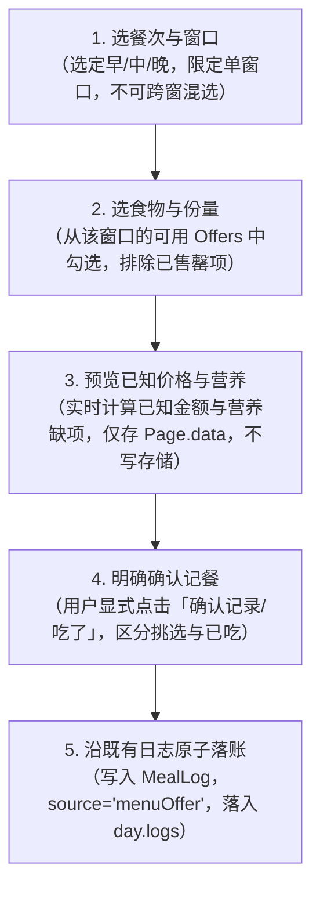

# T05S01｜反重力｜自选菜最小接入方案·交付反馈 v1

- 任务卡：`Resources/任务卡/T05S01-反重力-自选菜接口核对-v1.md`
- 执行方：反重力（Antigravity）
- 指定模型：**Gemini 3.8**；实际系统可见模型：**Gemini 3.8 Flash (High)**；原生思考档位：high；服务端真实子版本/配额：**未知**（窗口仅展示模型档位，服务端物理版本未知）
- 项目根：`D:\项目\cpp\Projects\食堂就餐优化系统`
- 权限与操作性质：**纯只读技术核对与方案报告**。未运行任何会写项目/用户数据的编译、GUI 或修改操作；未修改源码、配置、WASM 或存储。
- 结论状态：**技术梳理与接口核对完成，方案已形成闭环；本卡不实施代码改动，不声明自选菜功能已实现或验收通过**。

---

## 一、输入文件与读取候选身份

本卡执行期间，严格按照任务卡要求按需读取稳定文件及进行中的前后端资产。经核实，前端执行员 DSH 刚完成 `T05U05` 界面整合并生成了证据目录，但尚未由 P01 正式查收。本报告如实记录读取时点的工作区与文件身份：

| 资产 / 文件路径 | 修改时间（时区：+08:00） | 大小 / 摘要 / 版本身份 | 备注与读取要点 |
| --- | --- | --- | --- |
| `Resources/报告/T05U04-DSH-我的与设置收口-交付反馈-v1.md` | 2026/10/21 20:38:51 | 12,195 B / 声明输出摘要 `sha256:8625eb9c...` | 确认 U04 交付边界与 U05 接续提示（`pages/profile`、`budget`、`data` 均无第二套持久化） |
| `Resources/任务提示词/T05U05-DSH-界面整合-v3.md` | 2026/10/21 20:45:27 | 9,346 B | 确认 DSH 持有当前前端界面整合写入权；明确 U05 不实现自选菜 |
| `Resources/报告/T05U05-DSH-界面整合-证据-v1/00-输出候选/diff-vs-u04.json` | 2026/10/21 22:27:44 | 26 行 / 输出候选 `sha256:35671f0e98...` (69 文件/711,302 B) | DSH 刚生成的 U05 候选；尚未提交正式反馈 `T05U05-DSH-界面整合-交付反馈-v1.md`，P01 尚未查收 |
| `miniprogram/src/assets/wasm/mp_core.wasm` | 2026/10/20 18:03:52 | 72,881 B / SHA-256 `715CD7701B64D8F493A110C348B5F643979536578C7380C29837E05C4F31D52C` | 核心 WASM 二进制冻结，完全未改动 |
| `miniprogram/src/pages/home/index.ts` | 2026/10/21 22:17:27 | 31,108 B / 803 行 | 核对 L178-179 `selfPickOpen/selfPick`、L599-616 `onOpenSelfPick`、L669 `onToggleItemLock`、L713-786 `onSwapMeal`/`pickOfferAndSwap` |
| `miniprogram/src/pages/home/index.wxml` | 2026/10/21 22:17:32 | 18,479 B / 411 行 | 核对 L122 入口 `<text class="link link-pick" bindtap="onOpenSelfPick">自己选菜</text>`、L381-396 假提示弹层 |
| `miniprogram/src/domain/store.ts` | 2026/10/21 20:59:55 | 84,459 B / 1897 行 | 核对 L617 `toggleWindowLock`、L651 `toggleItemLock`、L697 `swapOffer`、L899 `confirmMeal`、L988 `addManualLog`、L236 `commit` |
| `miniprogram/src/domain/plan.ts` | 2026/10/21 20:58:03 | 36,638 B / 848 行 | 核对 L158 `mealHasSupply`、L167 `planningMeals`、L188 `validateLocks`、L292 `buildPlanRequest`、L367 `itemViewFromPlanItem`、L420 `totalFromItems`、L500 `interpretMeal` |
| `miniprogram/src/domain/logs.ts` | 2026/10/21 20:56:55 | 18,702 B / 391 行 | 核对 L56 `summarizeActiveLogs`、L203 `buildIntakeView`、L259 `buildBudgetView`、L356 `buildLogView` |
| `miniprogram/src/domain/types.ts` | 2026/10/21 16:17:41 | 22,233 B / 605 行 | 核对 `Catalog` (L114)、`Offer` (L95)、`Dish` (L77)、`MealLog` (L202)、`MealLogItem` (L221) |
| `miniprogram/src/utils/money-display.ts` | 2026/10/21 20:56:26 | 2,316 B / 65 行 | 核对 `priceLabel`、`paidItemLabel`、`PRICE_PENDING`、`PAID_PENDING` |
| `Resources/契约/T01-v1.2-candidate/contract-v1-candidate.md` | 2026/10/20 11:32:00 | 12,854 B | 冻结契约：核对 L14、L59-65 (Catalog/Offer/米饭/套餐)、L91 (PlanRequest/State)、L102 (MealLog 结构) |
| `core/include/mp/contract.h` | 2026/10/20 18:03:52 | 2,416 B / 65 行 | 核对 C++ 仅暴露 `ComputeNutritionTargetEntry`、`ValidateMenuCatalogEntry`、`PlanDayEntry` 三大入口 |

> **差异与读取说明**：U05 刚改写了 `miniprogram/src/pages/home/index.ts`、`home/index.wxml`、`domain/store.ts` 等 13 个文件并新增了 `utils/money-display.ts`。本报告完全基于这套最新稳定的代码现状进行核对。因 U05 正式报告尚未归档，本报告不替代 P01 对 U05 交付结果的查收。

---

## 二、现有能力表

本表逐项盘点从“进入自选”到“落账记餐”全流程中已有的函数、类型与逻辑，严格标明可复用性与定位。

| 步骤 / 需求能力 | 代码定位（函数/类型/路径） | 判定 | 现状分析与代码依据 |
| --- | --- | --- | --- |
| **1.1 餐次选择与有效性** | `Meal` (`domain/types.ts` L25)<br>`MEALS` (`domain/types.ts` L34)<br>`mealHasSupply(catalog, meal)` (`domain/plan.ts` L158)<br>`isMealEnded(day, meal)` (`domain/app-state.ts`) | **可复用** | 现有类型完整支持早/中/晚三餐枚举；已有 `mealHasSupply` 过滤无供应餐次；已有 `isMealEnded` 判断已结束餐次。 |
| **1.2 窗口选择与过滤** | `CatalogWindow` (`domain/types.ts` L108)<br>`store.catalog().windows` (`domain/store.ts` L271)<br>`window.mealWindows.indexOf(meal) >= 0` | **可复用 / 需适配** | **数据层完全具备**：菜单中窗口及餐次关联明确；<br>**UI 层需适配**：当前 `home/index.ts` 仅绑定了推荐方案的单个窗口（`planMeal.windowName`），手选弹层需要提供单窗口切换选择器。 |
| **2.1 单窗口内可选菜品查询** | `Offer` (`domain/types.ts` L95)<br>`Dish` (`domain/types.ts` L77)<br>`store.catalog().offers` (`domain/store.ts` L271) | **需适配** | **底层数据完全具备**；但 `store` 目前仅有推荐方案下的 `swappableOffers`（`domain/plan.ts` L584），**缺少通用查询方法**（如 `store.getAvailableOffers(meal, windowId)`），需适配一个按指定窗口和餐次筛选有效 Offer 的查询函数。 |
| **2.2 售罄状态拦截** | `day.soldOut` (`domain/types.ts` L194)<br>`soldOutKey(meal, windowId, dishId)` (`domain/plan.ts` L202, `store.ts` L670) | **可复用** | 售罄检查逻辑在 `store.toggleItemLock` (L670-674) 与 `validateLocks` 中已严格限定为 `(meal, windowId, dishId)` 三元组，同菜在它窗售罄不误伤本窗，可直接用于手选时置灰已售罄项。 |
| **2.3 份量选择 (整/半份)** | `Offer.portionCode: 'full' \| 'half'` (`domain/types.ts` L100)<br>`portionRatioNum / portionRatioDen` (`domain/types.ts` L101-102) | **可复用** | 份量完全由 Catalog 中真实存在的 `Offer` 表达。未在菜单中提供半份 Offer 的菜品不可选半份，从源头上杜绝了无效份量，无需前端编写自定义份量推导逻辑。 |
| **3.1 价格计算与未知处理** | `offer.priceCents` / `priceBasis` (`domain/types.ts` L103-104)<br>`totalFromItems` (`domain/plan.ts` L420)<br>`paidItemLabel` / `PRICE_PENDING` (`utils/money-display.ts` L1-L40) | **可复用** | 米饭半份同价已在 Catalog 的 Offer 中固化；套餐按 `comboTotal` 计入；未知价格（null）不按 0 计入；U05 统一的 `money-display.ts` 可直接复用于单项和总价展示（“已知实付 ¥X（含未填项）”/“实付待补全”）。 |
| **3.2 营养计算与缺项汇总** | `Dish.nutrition` (`domain/types.ts` L85)<br>`Offer.nutritionOverride` (`domain/types.ts` L105)<br>`Dish.nutritionBasis.estimated` (`domain/types.ts` L88)<br>`summarizeActiveLogs` (`domain/logs.ts` L56) | **需适配** | **规则可复用**：`offer.nutritionOverride` 优先，否则取 `dish.nutrition` 按 `portionRatioNum / portionRatioDen` 缩放，估算标记透传；<br>**需适配**：当前营养汇总内联在 `interpretPlanResult` 与 `logs.ts` 中，需抽取轻量纯函数用于手选草稿的实时预览。 |
| **3.3 挑菜/预览纯内存状态** | `Page.setData({ selfPickDraft: ... })` | **可复用** | 严格限定在前端页面局部 `data` 中，在用户点击确认前**绝不调用 `store.commit`**，不修改 `day.plan`，不写入 `day.logs`，天然保证“挑选不等于已吃”。 |
| **4.1 方案确认接口 (现有)** | `store.confirmMeal(meal, priceEdits)` (`domain/store.ts` L899-L980) | **不适用 (无法复用)** | `confirmMeal` 强依赖 `day.plan!.rawText` 与 `selected.planKey`（L911-917），无推荐方案时直接抛错；只适用于落实 AI 推荐方案，不能用于自选菜。 |
| **4.2 手动补记接口 (现有)** | `store.addManualLog(meal, input)` (`domain/store.ts` L988-L1050) | **不适用 (无法复用)** | 仅支持单条纯手输食物（`source: 'manual'`，`offerId: null`，`dishId: null`），丢失了菜单版本、报价引用和菜品快照，不支持一次性落单窗口多道菜单菜品。 |
| **4.3 契约日志结构与落账存储** | `MealLog` (`domain/types.ts` L202)<br>`MealLogItem` (`domain/types.ts` L221)<br>`store.commit` (`domain/store.ts` L236) | **底层完全就绪，缺少上层调用方法** | **契约结构完全支持**：`MealLogItem` 原生支持 `source: 'menuOffer'`、`offerId`、`dishId`、`nameSnapshot`、`nutrition` 等；<br>**存储完全支持**：`commit` 原子写 `day.logs`；<br>**唯一缺失**：`store` 缺少一个专供自选菜落账的方法（如 `store.confirmSelfPickMeal`）。 |
| **5.1 记餐后与后续规划联动** | `planningMeals` (`domain/plan.ts` L167)<br>`buildPlanRequest` (`domain/plan.ts` L292)<br>`interpretMeal` (`domain/plan.ts` L519) | **可复用 / 需小适配** | 一旦自选菜落入 `day.logs`，`planningMeals` 自动将该餐排除出待规划列表；`buildPlanRequest` 自动将该记录作为 `activeLogs` 发给 WASM 算法，后续餐次推荐自动适应剩余摄入与预算。<br>**需适配**：`interpretMeal` (L519) 的条件 `if (confirmed && !planMeal)` 需优化为 `if (confirmed)`，确保已自选记餐后今日页立即展示实际已吃，而非残留的旧推荐。 |

---

## 三、一条最小闭环方案

### 3.1 五步最小闭环流程



1. **选餐次与窗口**：
   - 用户在今日页选择当前餐次（如午餐）；
   - 打开“自己选菜”弹层，系统默认选中当前方案推荐的窗口，或供用户在当前餐次有供应的窗口列表中切换（如“1号自选窗口”）；
   - **单窗口约束**：点餐作用域严格封闭在所选窗口内，页面只列出该窗口在该餐次供应的报价，天然杜绝跨窗口无效组合。
2. **选食物与份量**：
   - 页面展示该窗口可售菜品（按主食、荤菜、素菜、汤饮分类）；
   - 售罄检查：若 `(meal, windowId, dishId)` 在 `day.soldOut` 中，置灰显示“已售罄”且不可勾选；
   - 份量选择：直接选择具体的 `Offer`（如“米饭整份”或“米饭半份”）。若菜品没有半份 Offer，则界面不提供半份选项，天然保证份量真实可售。
3. **看已知价格/营养及缺项**：
   - **纯内存计算**：用户勾选、增减数量时，仅驱动 `Page.data` 的草稿数据刷新；
   - **价格与缺项**：米饭半份直接按该 Offer 报价（与整份同价）；套餐按 `comboTotal` 计入，子菜不重复收费；未知价格项标“价格待补”；总价按 `money-display.ts` 口径显示（全已知显示“¥X.XX”，部分已知显示“已知金额 ¥X.XX（含未填项）”，全部未知显示“实付待补全”）；
   - **营养与缺项**：各菜品按份量比例缩放营养；有缺失字段标记“营养未知”；若包含估算数据，打上“估算”徽标；
   - **严格原则**：挑选与预览阶段不触发任何存储写入，绝不把浏览当作已吃。
4. **明确确认**：
   - 弹层底部提供明确的主操作按钮：“确认吃了”或“记录这餐”（若未选任何菜品则禁用）；
   - 支持单项实付价格微调（同记录页核对面板，允许用户修正实际刷卡金额，或明确置为未知 null）；
   - 提供明确的“取消/关闭”按钮，点击后关闭弹层并丢弃草稿，数据状态无任何变动。
5. **沿既有日志保存**：
   - 用户点击确认后，生成客户端幂等键 `clientToken`；
   - 领域层将勾选的 Offer 列表构造为一条标准 `MealLog`：
     - `confirmationId = "conf-selfpick-" + businessDate + "-" + meal + "-" + clientToken`；
     - 每项置为 `source: 'menuOffer'`，固化 `offerId`、`dishId`、`menuVersion`、`nameSnapshot`、`unitPriceCents`、`priceKnown`、`nutrition` 等快照；
   - 调用 `store.commit` 写入 `day.logs` 并持久化；
   - 写入完成后关闭弹层，今日页该餐状态刷新为“已吃”，后续规划自动适应。

---

### 3.2 与“先锁定后重新推荐”的关键区别

| 维度 | 先锁定后重新推荐（现有辅助规划） | 自选菜最小闭环（本卡方案） |
| --- | --- | --- |
| **业务目标** | **AI 辅助规划**：用户给约束种子（如想吃红烧肉），让算法寻找全天最佳搭配。 | **用户真实记餐**：用户在食堂自主打餐，明确记录自己实际吃了什么。 |
| **核心算法参与** | **强依赖 C++ WASM `PlanDayEntry`**，执行贪心搜索与营养/预算约束校验。 | **完全不调用 C++ 规划算法**；纯前端/领域层数据映射与落账。 |
| **数据落脚点** | 写入 `day.itemLocks` / `day.windowLocks` 和 `day.plan`（**方案状态，非已吃**）。 | 写入 `day.logs`（**正式事实记录，status='active'**）。 |
| **菜品组合控制** | 用户无法精确控制全部组合；算法会自主搭配其他菜品补齐热量/营养。 | **完全由用户自主挑选决定**，所见即所记，不添菜、不删菜、不编造。 |
| **无解与冲突风险** | **存在失败风险**：若锁定项超预算或营养冲突，算法返回 `LockConflict` 或无方案。 | **零无解风险**：自主点餐属于用户既成事实，只要菜品在售即可直接记录。 |
| **后续餐次影响** | 覆盖当前方案 `day.plan`，重新计算全天餐次。 | 将该餐标记为已吃，算法在规划后续餐次时以该餐为已消耗历史，自适应剩余指标。 |

---

## 四、边界处理

本方案对 7 大业务边界的处理口径如下，严格区分计划状态（Plan）与事实记录（Log）：

1. **已吃餐次（Already Confirmed）**：
   - *现有规则*：`day.logs` 中存在该餐 `status === 'active'` 记录时，`planningMeals` 排除该餐，`confirmMeal` 返回幂等成功（不重复记录）。
   - *自选菜处理*：若当前餐次已有已吃记录，今日页的“自己选菜”按钮变为置灰或点击提示：“该餐已确认已吃；如需修改，请到记录页撤销或调整原记录”。禁止重复叠加自选，防止产生两条冲突的就餐事实。
2. **已结束餐次（Ended Meal）**：
   - *现有规则*：`day.endedMeals` 记录用户放弃的餐次，`isMealEnded` 为 true。
   - *自选菜处理*：已结束餐次不允许直接点餐。若用户点击自选，提示：“该餐已标记为不吃；若要自选点餐，请先重开该餐”，引导用户显式调用 `store.reopenMeal` 后再选。
3. **未知营养或价格（Unknown Nutrition / Price）**：
   - *现有规则*：契约规范与 `money-display.ts` 明确禁止把未知计为 0。未知价格 `priceCents = null`，未知营养 `nutrition = null`。
   - *自选菜处理*：自选菜在预览和最终落账时严格沿用此规则：
     - 单项未知价格标“价格待补”；总价含未知项时标“已知金额 ¥X（含未填项）”；全部未知标“实付待补全”；真实已知 0 元显示“¥0.00”；
     - 营养缺失标明“含营养未知项”；
     - 记录存入 `MealLogItem` 时，保留 `priceKnown: false` 与 `nutrition: null`，后续月历和记餐页自动正确展示。
4. **份量不可售（Portion Not Available）**：
   - *现有规则*：Catalog 中菜品份量由独立的 `Offer` 实体承载。
   - *自选菜处理*：界面不提供无差别的“半份开关”；仅当所选菜品在当前窗口确实存在 `portionCode === 'half'` 的 Offer 时才允许切换。无半份报价的菜品仅能选整份，天然防范不可售份量组合。
5. **套餐计价与组件（Combo Dishes）**：
   - *现有规则*：契约中套餐为 `kind: 'combo'`，`Offer` 标 `priceBasis: 'comboTotal'`，组件由 `components` 列出。当前 `comboRules` 为空，不涉及动态套餐凑单。
   - *自选菜处理*：展示固定套餐 Offer，价格按 `comboTotal` 计入总额；其包含的子组件仅作展示说明，不作为独立项目重复计价。
6. **取消操作（Cancel Action）**：
   - *现有规则*：弹层关闭或取消不应污染持久化数据。
   - *自选菜处理*：用户在自选弹层内的所有勾选、加减、修改实付均暂存在页面的临时 `selfPickDraft` 中；点击“取消”或“关闭遮罩”仅清空临时草稿并关闭弹层，**不调用任何 store 写入方法，原计划和原记录均毫发无损**。
7. **重复确认与幂等（Duplicate Confirmation）**：
   - *现有规则*：`confirmMeal` 与 `addManualLog` 均使用 `confirmationId` 进行防重。
   - *自选菜处理*：下一卡新增的自选记餐方法构建确定的幂等键：
     `confirmationId = "conf-selfpick-" + businessDate + "-" + meal + "-" + clientToken`；
     执行写入前先检查 `day.logs`，若已存在相同 `confirmationId`，直接返回 `{ ok: true, duplicate: true }`，彻底防止因双击或网络抖动导致的重复累计。

---

## 五、最小实施建议与落地路线

### 5.1 核心算法结论

> [!IMPORTANT]
> **结论：自选菜功能完全不需要新增或修改任何 C++ 算法，也不需要重新编译 WASM 二进制！**
> 当前页面提示中出现的 *“核心尚未提供手选入口”* 属于前期的表述偏差。C++ WASM 负责的是“在海量组合中求解满足营养/预算的推荐方案”；而当普通用户“自己选菜”时，决策者已经是用户本人。底层的 T01 v1.2 契约和数据结构对包含多个 `source: 'menuOffer'` 的 `MealLog` 早就具备了原生完备支持。

### 5.2 建议改动的具体模块与改动点

实施自选菜仅需在前端与领域层改动以下两个模块：

1. **领域层 `miniprogram/src/domain/store.ts`（新增 1 个核心写入方法 + 1 个查询辅助方法）**：
   - **新增 `confirmSelfPickMeal`**：
     ```ts
     confirmSelfPickMeal(
       meal: Meal,
       windowId: string,
       selections: { offerId: string; quantity: number; priceEdit?: number | null }[],
       clientToken: string,
     ): ActionResult
     ```
     - 校验餐次未结束、未确认、所选 Offers 属于该窗口且在售；
     - 构造标准 `MealLog`（包含各 Offer 的菜品名快照、报价快照、份量、价格、按比例缩放的营养与估算标记）；
     - 通过 `this.commit` 原子存入 `day.logs`。
   - **新增 `getAvailableOffers(meal: Meal, windowId: string)`**：
     - 返回指定窗口在该餐次下的全部 Offer，挂载菜品名、分类、价格标签、份量标签和 `soldOut` 状态，供 UI 直接渲染，避免页面层重复写过滤逻辑。
2. **视图层 `miniprogram/src/pages/home/`（替换假提示弹层为真实自选交互）**：
   - `index.wxml`：替换现有 L381-396 的 `selfPick` 假提示弹层为真实自选菜抽屉（包含窗口切换标签、按分类展示的菜品多选列表、份量切换、实时已知金额与营养汇总条、取消与“确认吃了”按钮）；
   - `index.ts`：改造 `onOpenSelfPick`，初始化所选窗口和可用菜品列表；处理勾选与数量变动，调用 `store.confirmSelfPickMeal`；确认成功后关闭弹层并刷新界面；
   - `index.wxss`：补充自选抽屉的菜品列表、分类标签与底部结算栏样式。
3. **只读逻辑微调 `miniprogram/src/domain/plan.ts`（1 处判定优化）**：
   - 优化 L519 的 `interpretMeal`：将 `if (confirmed && !planMeal)` 优化为 `if (confirmed)`。
   - 理由：无论该餐此前是否曾生成过旧的 AI 推荐方案，一旦用户自选记餐（`confirmed === true`），今日页该餐卡片必须优先展示用户实际已吃的自选菜快照，不再显示已被替代的旧推荐。

### 5.3 建议实施顺序

1. **第一步（领域层与单元测试）**：
   在 `domain/store.ts` 中实现 `confirmSelfPickMeal` 和 `getAvailableOffers`，并编写独立的 Node.js 静态测试脚本（验证：合法多菜品记录、售罄拦截、未知价格/营养保留、幂等防重）。
2. **第二步（前端交互接入）**：
   在 `pages/home/` 中替换现有弹层，接入窗口选择、菜品勾选、实时金额/营养预览及记餐提交。
3. **第三步（微信实测验证）**：
   在微信开发者工具中完整走通全流程：选窗口 → 勾选菜品与半份 → 查看已知/待补全金额 → 确认记餐 → 观察今日小结与记餐页落账，确认后续餐次推荐不受破坏。

---

### 5.4 本卡无法确定的问题（提交 P01 决策）

1. **自选记餐后，后续未吃餐次的推荐方案重算时机**：
   - *问题*：用户午餐自选记餐后，晚餐的推荐方案是否立即在后台自动静默重新规划？
   - *建议*：不进行静默后台规划。沿用现有机制：落账后清空未吃餐次的旧 plan，在今日页提示“午餐已确认，点击‘刷新方案’以根据剩余指标规划后续餐次”，由用户显式触发，避免后台卡顿。
2. **自选菜界面的呈现形态（底部抽屉 BottomSheet vs 独立二级页面）**：
   - *问题*：目前今日页使用底部弹层（`.sheet`）承载。但若单个档口菜品数量较多（如超过 15 道），弹层滚动区域和分类导航可能较挤。
   - *建议*：第一期最小改动优先采用扩展型 `.sheet` 抽屉；若 P01/DSH 评估视觉更佳，亦可开辟独立次级页（如 `pages/self-pick/index`）。建议由 P01 统筹裁定。
3. **记录页（`pages/logs`）是否同步开放从菜单自选入口**：
   - *问题*：目前记录页只有“确认推荐（确认已吃）”和“手动补记（纯文本食物）”，是否也需要“从菜单选菜补记”？
   - *建议*：第一期按产品主需求将自选菜收敛在“今日页”，作为点餐主日常入口；记录页暂保持现状，避免多页面并发改造引起回归。

---

## 六、交接与责任声明

- **本卡性质**：只读技术梳理、接口核对与最小接入架构方案。
- **下一负责人**：交 **P01** 核定自选菜接入方案；待 `T05U05` 界面整合查收后，由 P01 正式下发自选菜实现任务卡（建议由小程序前端 DSH 接手实施）。
- **执行纪律**：本卡已完成全部核对与交付报告，执行停止；不私自联系其他窗口、不擅自派发实现、不轮询 U05 状态。
